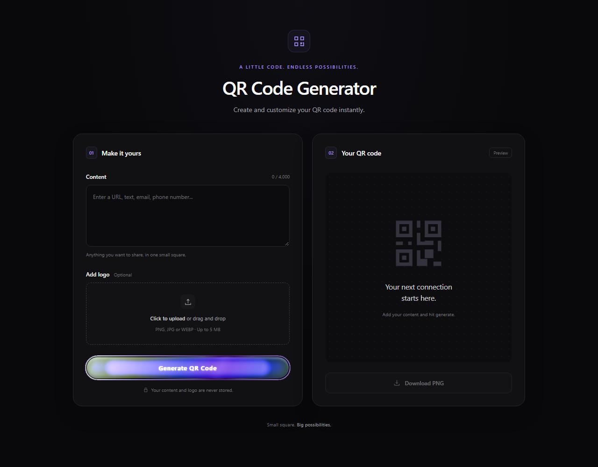

<div align="center">

# QR Code Generator

**Small square. Big possibilities.**

Create a QR code from any text or link, add your logo, and download a PNG in seconds.


[Features](#features) · [Get started](#get-started) · [Deployment](#deployment) · [API documentation](https://qr-code-api-ce0a.onrender.com/docs)

</div>



## About

A focused QR generator with a dark interface, violet accents, and a responsive two-panel workspace. Enter your content on one side, then preview and download your QR code on the other.

This public repository contains the **React frontend only**. QR generation runs in a separate Python backend repository deployed on Render:

**Backend:** [qr-code-api-ce0a.onrender.com](https://qr-code-api-ce0a.onrender.com)

You can run and publish this frontend independently; you do not need the backend source code or a local Python installation.

## Features

| Feature | What you can do |
| --- | --- |
| Text and links | Turn a URL, message, email, or phone number into a QR code. |
| Custom logos | Upload a PNG, JPG, or WEBP image, preview it, or remove it before generating. |
| Instant preview | See the PNG returned by the API in a white QR preview frame. |
| PNG download | Save the generated image directly from the browser. |
| Repeat generation | Make another QR code without reloading the page. |
| Animated feedback | A violet gradient button and rotating cube show the generation state. |
| Responsive layout | Use the same interface on desktop, tablet, or mobile. |
| Accessible controls | Keyboard focus, labelled fields, status messages, and reduced-motion support. |

Logo uploads support files up to **5 MB** and **16 million pixels**. The backend processes logos and generated QR images in memory rather than saving them permanently.

## How it works

```text
Enter content → Add an optional logo → Generate → Preview → Download PNG
                                         │
                                FastAPI backend on Render
```

The frontend sends multipart form data to `POST /api/generate-qr`. The backend generates a black QR code on a white background and returns a PNG. The browser uses a temporary object URL for preview and download.

## Get started

Install Node.js and npm, clone this frontend repository, and open its root directory.

```bash
npm install
npm run dev
```

Open **http://localhost:5173**. The development server forwards `/api` requests to the deployed Render backend.

### Configuration

The app uses the Render backend by default. To configure a different backend, copy `.env.example` to `.env.local`:

```env
VITE_API_BASE_URL=https://qr-code-api-ce0a.onrender.com
```

Use the backend origin without `/api/generate-qr`; the app adds the route. Restart Vite after changing the file. Production environment values must be set before building because Vite embeds them in the generated JavaScript.

`VITE_` variables are visible to browser users. Keep credentials and private configuration in the backend repository.

## Deployment

Publish the contents of **`qr-code-web` as the root of your public frontend repository**, including `package-lock.json` and `.env.example`. Its `.gitignore` excludes dependencies, build output, and local environment files.

Connect that repository to your static hosting provider and use:

| Setting | Value |
| --- | --- |
| Install command | `npm ci` |
| Build command | `npm run build` |
| Publish directory | `dist` |
| Environment variable | `VITE_API_BASE_URL=https://qr-code-api-ce0a.onrender.com` |

The production frontend calls the Render backend directly, so it works when hosted separately from the API. Vite's development proxy is only used during local development.

**Backend setup:** allow your published frontend origin in the Render API's CORS configuration. This is configured in the separate backend repository; a frontend environment variable cannot enable CORS on the API.

For the current production site, set this variable on the **Render backend service** and restart or redeploy that service:

```env
FRONTEND_ORIGINS=https://qr-code-generator-five-mu.vercel.app
```

To preview a production build locally:

```bash
npm run build
npm run preview
```

Open **http://localhost:4173**. Production preview calls the backend directly, so the API must also allow this origin if you use it.

## Project structure

```text
qr-code-web/
├── docs/
│   └── preview.png       # Interface preview
├── src/
│   ├── App.jsx           # Generator, uploads, API requests, and preview
│   ├── main.jsx          # React entry point
│   └── style.css         # Dark theme, responsive layout, and animations
├── .env.example          # Public backend configuration
├── index.html
├── package.json
├── package-lock.json
└── vite.config.js        # React setup and development API proxy
```

## Credits

- Animated generate button adapted from **dexter-st** on [Uiverse.io](https://uiverse.io).
- Cube loader adapted from **andrew-demchenk0** on [Uiverse.io](https://uiverse.io).
- QR generation uses FastAPI, Python's `qrcode` package, and Pillow in the separate backend project.
